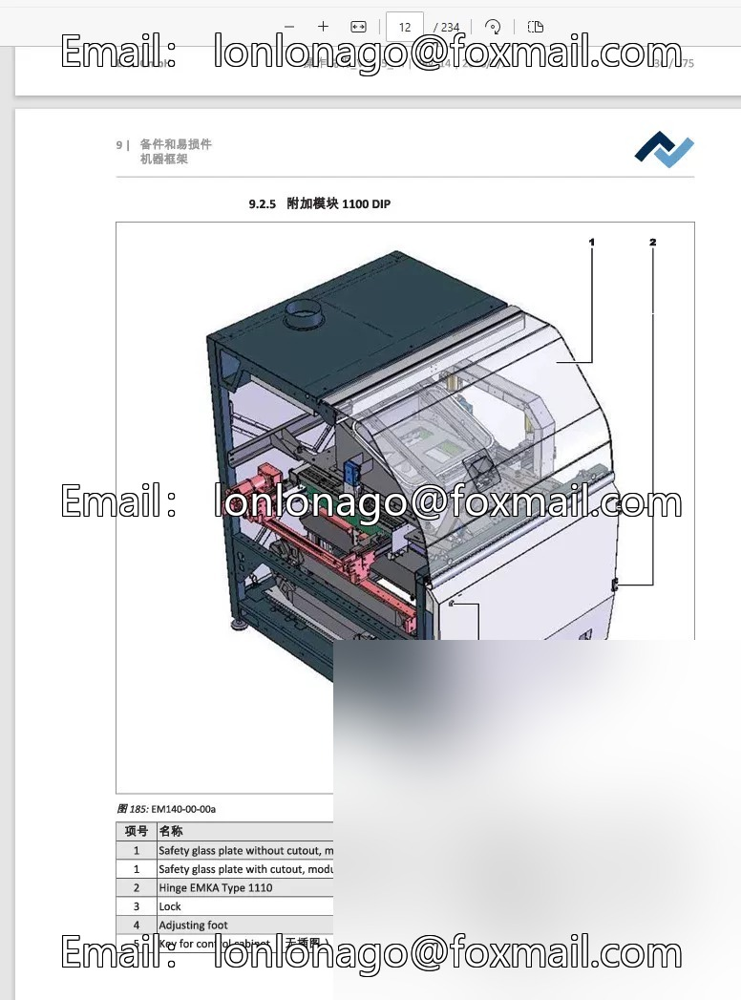
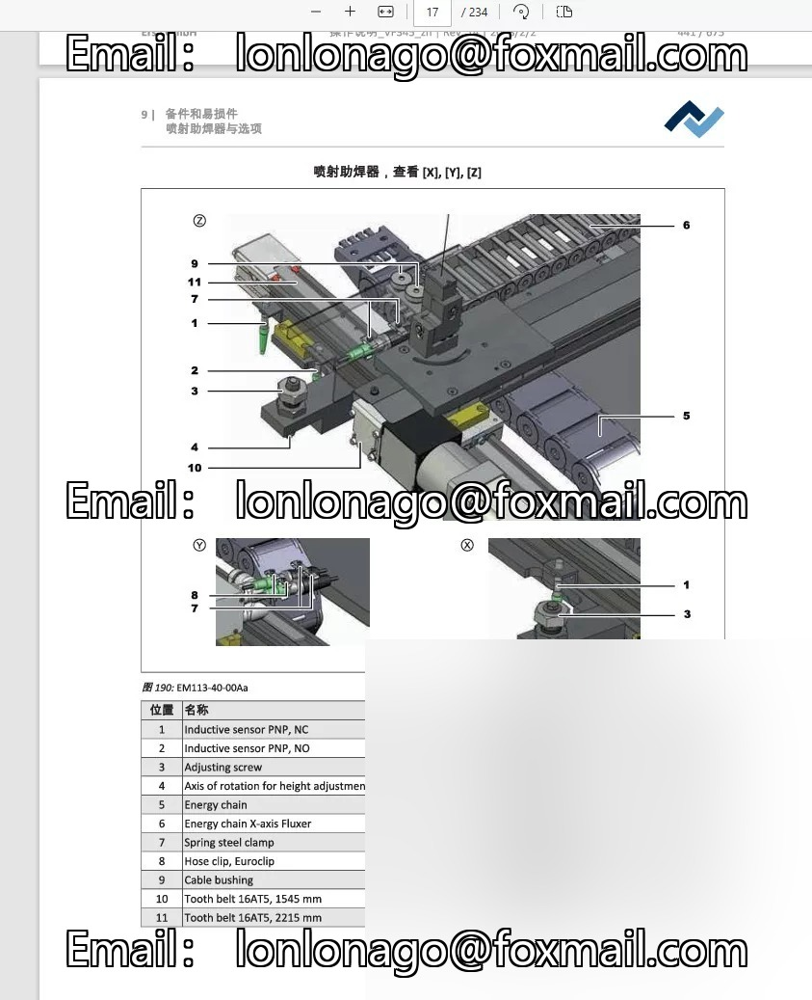
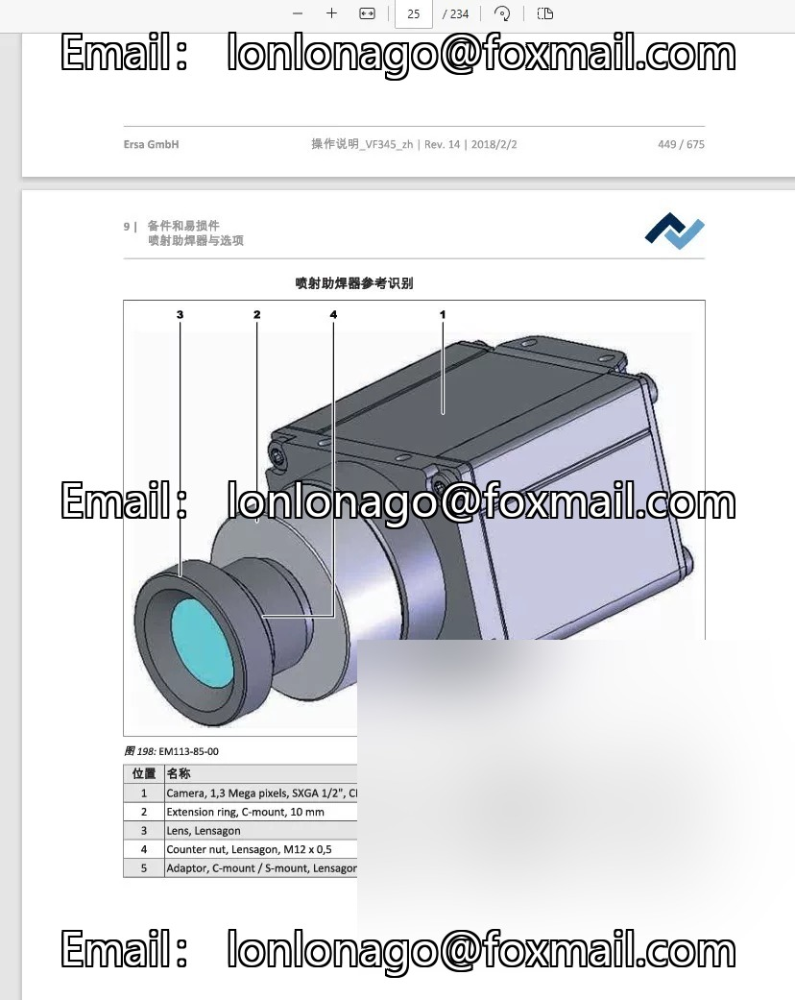
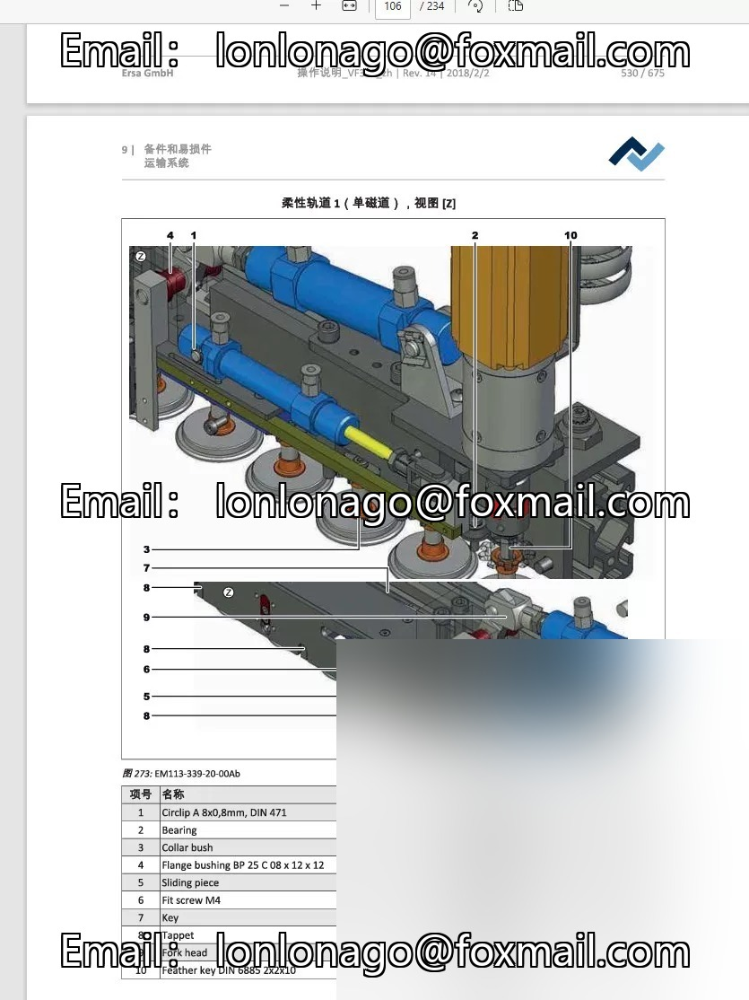
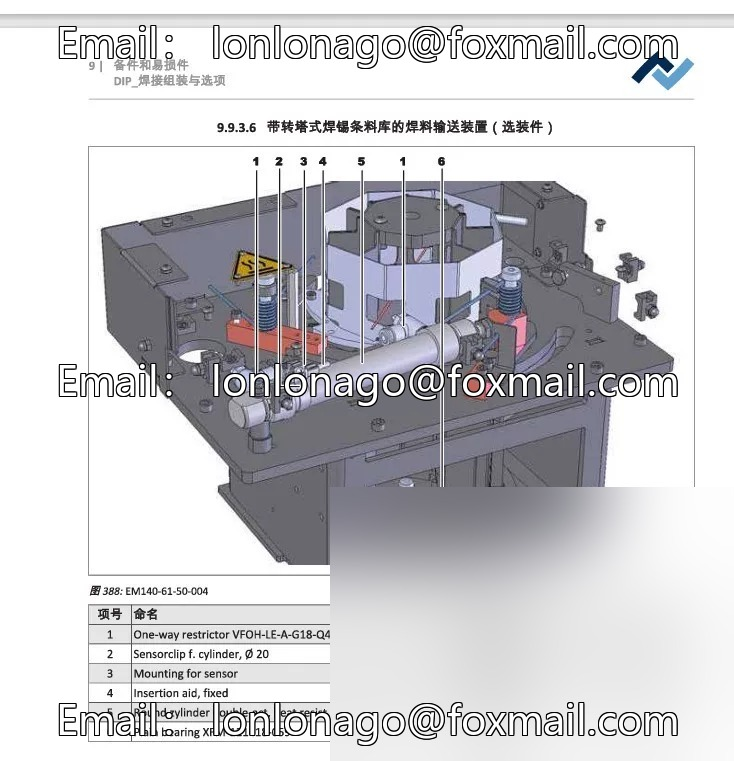

# Semiconductor laser welding equipment - part list chart PDF file - color exploded diagram, for research

## Body

Semiconductor laser welding equipment-Part list diagram PDF file-colorized exploded diagram, which has a strong intuitive reference for friends studying mechanical structure design!

Take a photo and directly send the electronic original file! Since the electronic file materials have the replicability, purchase is not allowed for returns! Thank you for understanding!

The part list chart includes a colored exploded view with multiple parts for mechanical structural reference.

<!-- AI_ENRICHED -->

## Images

## Payment

Here is a pay link on Stripe ( https://buy.stripe.com/3cs8yP7sY87d0vu9AB ). Please contact me lonlonago@foxmail.com after funding $89, and I will send you a complete data files , thank you!

